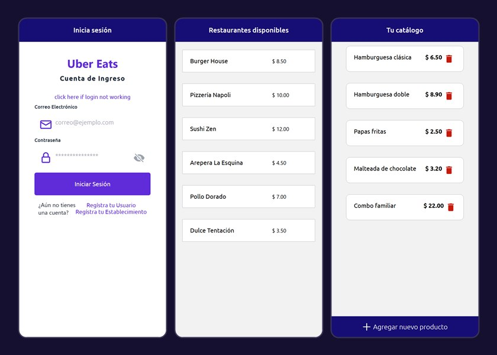

# Pegasus

A food delivery app in the style of Uber Eats, built with React Native and Expo. Customers browse the available restaurants, and restaurants register an establishment and manage their own product catalog. It was a university mobile development project, built in pairs in July and August 2021.



*Screens rendered with sample data: the original backend is no longer online.*

## Features

- **Sign up and sign in** for users and for establishments, each with its own registration form.
- **Restaurant list** for users, loaded from the API.
- **Catalog management** for establishments: list their products, create new ones, edit them and delete them.
- Stack navigation between all screens, with a custom Ubuntu font and a purple theme.

## Branches

This default branch (`p3`) has the base app. The delivery branches go further:

| Branch | What it adds |
|---|---|
| [`entrega2`](https://github.com/Dtowerssj/pegasus-app/tree/entrega2) | The most complete version: **Google Maps** screens with delivery routes (`react-native-maps` and `react-native-maps-directions`), a **shopping cart** and a **Stripe payment** screen (test mode) |
| `entrega-2` | An earlier step with the maps work |
| `entrega-2-useContext` | An attempt to move authentication to React Context, left unfinished |

The Google Maps API key is not included: you need your own to see the maps.

## Tech stack

- React Native with Expo (SDK 42)
- React Navigation (stack)
- Formik for the forms
- Axios and `fetch` for the REST API calls
- On the delivery branches: Google Maps (`react-native-maps`) and Stripe
- The REST API lives in a separate repository: [pegasus-backend](https://github.com/Dtowerssj/pegasus-backend) (Node.js, Express and PostgreSQL)

## Getting started

```bash
git clone https://github.com/Dtowerssj/pegasus-app.git
cd pegasus-app
npm install
npm start
```

1. Run the [backend](https://github.com/Dtowerssj/pegasus-backend) and set its address in `constants/index.js` (`API.HEROKU`) and the login URL in `screens/LoginScreen.js`. The hosted Heroku instance used at the time no longer exists.
2. Open the project with Expo.

> This project targets Expo SDK 42, released in 2021. Current versions of the Expo Go app only open projects built with recent SDKs, so you may need to upgrade the Expo SDK before running it on a device.

## Project structure

```
App.js              Entry point: fonts and navigation
navigation/         Stack navigator and screen titles
screens/            Login, registration, restaurant list, catalog and product forms
components/         List items, buttons and search bar
api/                Calls to the REST API
constants/          Colors and API address
styles/             Shared styles
```

## Language

The interface is in Spanish.
